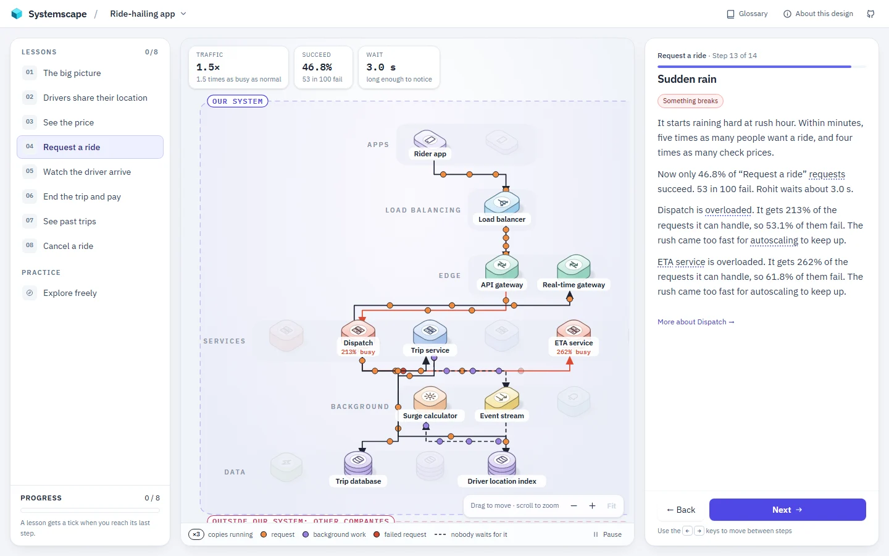
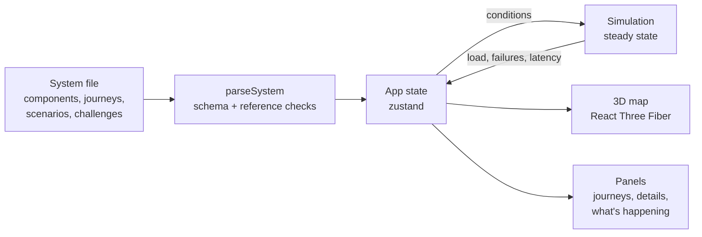

# Systemscape

[](https://github.com/iamrs77/systemscape/actions/workflows/ci.yml)

See how big apps are built, in 3D. Pick a system, watch requests flow through it, push the traffic up, break things, and find out what keeps it running.

The first system is a **ride-hailing app** like Uber or Ola. Four more are on the way: a stock trading app, video streaming, UPI payments, and [Stockroom](https://github.com/iamrs77/stockroom), my own inventory app.


## About

Architecture diagrams are static: they show the boxes, not what happens when Friday night arrives or the cache falls over. Systemscape puts a live model behind the diagram.

- **Explore the design.** Every part of the system is a shape on a 3D map, grouped in rows from the apps at the front to outside providers at the back. Click one to see what it does, why the design needs it, what users notice when it fails, and how it scales.
- **Follow a journey.** Pick something people do, like requesting a ride, and see only its requests: the steps they take, which ones are optional or happen in the background, and where the time goes.
- **Push the traffic.** Switch between an ordinary evening, Friday night, a sudden rainstorm and New Year's Eve, or drag the traffic up yourself. Parts get busy, slow down and start failing, and the failures spread the way they do in real systems.
- **Break things and fix them.** Take any part down, add instances, and turn autoscaling, retries and circuit breakers on and off. A panel explains what's happening in plain words: what's failing, why, and what the system is doing about it.
- **Take on challenges.** Each one breaks something the way it happens in real life, with a goal checked live as you change things. Solve it and you get the lesson behind the fix.
- **Check the sources.** The design is based on engineering talks and posts, listed with each system, and says plainly that it's a simplified version, not any company's actual system.

| A challenge: caught in the rain                                        | Following a journey on a Friday night                                                   |
| ---------------------------------------------------------------------- | --------------------------------------------------------------------------------------- |
|  |  |

## How it works

Everything runs in the browser. There's no server: a system is a data file, and the simulation runs every time you change something.



- **A system is data.** Components, the journeys through them, traffic scenarios and challenges live in one TypeScript file, checked by a zod schema and a second pass that every id it mentions exists. A typo fails the tests, not the 3D view.
- **The simulation finds where things settle.** Load and failures feed each other (failures cause retries, retries add load, load causes failures), so it iterates until the numbers stop changing. It models queueing delay, overload, timeouts, retries, circuit breakers, caches, optional and background steps, and autoscaling that can't keep up with a sudden rush. It's deterministic and takes under a millisecond.
- **Every challenge is tested to be fair.** A test checks that each one fails its goal at the start and that a sensible fix solves it, so no challenge is impossible or already solved.
- **Labels are real HTML.** The names over the 3D map are buttons, so they're sharp, can be reached with the keyboard and read by screen readers. When two would overlap, the more important one shows: what you selected, then what's failing.
- **It works on phones.** The map refits for a tall screen, labels shrink, and details slide up from the bottom.
- **Small first load.** The page loads 116 KB of JavaScript (gzipped). three.js, 259 KB more, loads after the page shows.

The design, the simulation's formulas and the reasons behind each decision are in the [documentation](#documentation).

## Tech stack

| Part        | Tools                                                              | Why                                                                                                                                                                 |
| ----------- | ------------------------------------------------------------------ | ------------------------------------------------------------------------------------------------------------------------------------------------------------------- |
| App         | React 19, TypeScript, Vite                                         | Fast to build and reload, and strict types catch a broken system file before it runs.                                                                               |
| 3D          | three.js, React Three Fiber, drei                                  | The scene is described as React components that share state with the panels, instead of a second app talking to the first.                                          |
| State       | zustand                                                            | One small store for the conditions and the simulation's result; components subscribe to just the slice they draw.                                                   |
| Data checks | zod                                                                | Each system file is validated when the app starts and in the tests.                                                                                                 |
| Styling     | Tailwind CSS 4                                                     | Quick to build a consistent dark interface, with nothing to load at runtime.                                                                                        |
| Tests       | Vitest, Testing Library, Playwright                                | The simulation and every challenge are unit tested; the panels are tested like a person would use them; Playwright runs the real 3D build on a desktop and a phone. |
| Tooling     | ESLint (with the React Compiler's rules), Prettier, GitHub Actions | Checked on every push, along with the types, tests and build.                                                                                                       |

## Running it

You need Node.js 22 or newer.

```bash
npm install
npm run dev          # http://localhost:5173
```

| Command          | What it does                                                                                                                   |
| ---------------- | ------------------------------------------------------------------------------------------------------------------------------ |
| `npm test`       | Unit and component tests (Vitest)                                                                                              |
| `npm run e2e`    | Browser tests against the production build (Playwright; run `npm run build` first, and `npx playwright install chromium` once) |
| `npm run build`  | Type-checks and builds the static site into `dist/`                                                                            |
| `npm run lint`   | ESLint                                                                                                                         |
| `npm run format` | Prettier                                                                                                                       |

The build is a static site with relative paths, so `dist/` can be served from any folder on any static host.

## Project structure

```
src/
  model/      the data format for a system (zod schema), and parseSystem, which checks it
  sim/        the simulation, number formatting, and the plain-words explanations
  systems/    one file per system, and the challenge helpers
  scene/      the 3D map: layout (pure, tested), camera fit, shapes, connections, labels
  ui/         the panels: journeys, challenges, details, controls, dialogs, the tour
  store.ts    the app's state, and the actions that re-run the simulation
e2e/          Playwright tests
docs/         architecture, decisions, and how to add a system
```

## Documentation

- [Architecture](docs/architecture.md): how the parts fit, the simulation in detail, the 3D scene, and the limits.
- [Adding a system](docs/adding-a-system.md): what goes in a system file, and how it's checked.
- Decision records:
  [1. A static site](docs/adr/0001-static-site.md) ·
  [2. A steady-state model](docs/adr/0002-steady-state-model.md) ·
  [3. Systems as data](docs/adr/0003-systems-as-data.md) ·
  [4. HTML labels over the canvas](docs/adr/0004-html-labels.md) ·
  [5. Honest about what's real](docs/adr/0005-honest-about-sources.md) ·
  [6. The tech stack](docs/adr/0006-tech-stack.md)

## License

[MIT](LICENSE)
