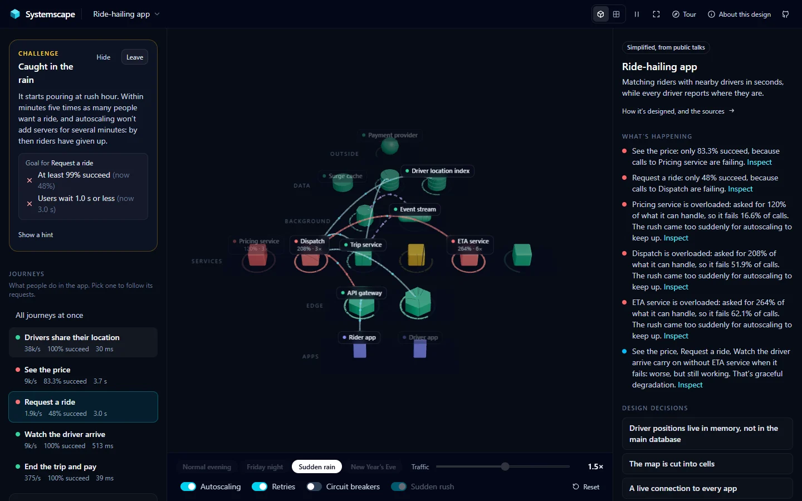
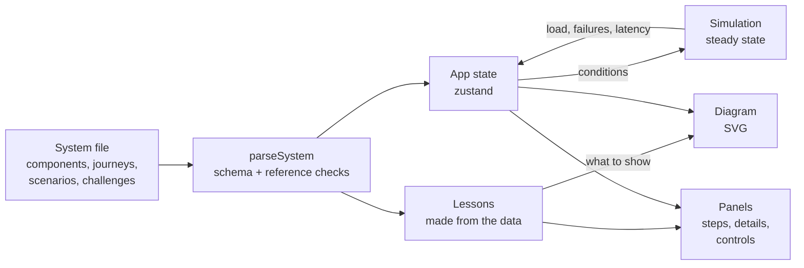

# Systemscape

[](https://github.com/iamrs77/systemscape/actions/workflows/ci.yml)

Learn how big apps are built, one step at a time. Pick an app you use every day and take its backend apart: what each part does, how a request travels through them, and what breaks when everyone shows up at once.

The first system is a **ride-hailing app** like Uber or Ola. Four more are on the way: a stock trading app, video streaming, UPI payments, and [Stockroom](https://github.com/iamrs77/stockroom), my own inventory app.


## About

Architecture diagrams are static: they show the boxes, not what happens when Friday night arrives or the cache falls over. Systemscape puts a live model behind the diagram, and walks you through it.

- **Start with the big picture.** The first lesson goes through the system a row at a time, from the apps at the top to the data at the bottom: what each part is for, and why the design needs it.
- **Follow a request.** Each journey, like requesting a ride, is a lesson with a step per call: who calls whom, who waits, what's optional or happens in the background, and where the time goes. The diagram zooms in on each call as you go.
- **See what breaks.** Each lesson ends on the night that's hardest on its journey (Friday night, a sudden rainstorm, New Year's Eve): what gets overloaded, how the failure spreads, and how many requests still succeed.
- **Fix it.** Challenges break something the way it happens in real life, with a goal checked as you change things. Add copies, switch on circuit breakers, and get the lesson behind the fix.
- **Explore freely.** In the sandbox, change anything: traffic, copies, retries, which parts are up. A line over the diagram says what's failing, why, and what the system is doing about it.
- **Check the sources.** The design is based on engineering talks and posts, listed with each system, and says plainly that it's a simplified version, not any company's actual system.

| A challenge: caught in the rain                                        | What breaks on New Year's Eve                                                                    |
| ---------------------------------------------------------------------- | ------------------------------------------------------------------------------------------------ |
|  |  |

## How it works

Everything runs in the browser. There's no server: a system is a data file, and the simulation runs every time you change something.



- **A system is data.** Components, the journeys through them, traffic scenarios and challenges live in one TypeScript file, checked by a zod schema and a second pass that every id it mentions exists. A typo fails the tests, not the diagram.
- **The simulation finds where things settle.** Load and failures feed each other (failures cause retries, retries add load, load causes failures), so it iterates until the numbers stop changing. It models queueing delay, overload, timeouts, retries, circuit breakers, caches, optional and background steps, and autoscaling that can't keep up with a sudden rush. It's deterministic and takes under a millisecond.
- **Every challenge is tested to be fair.** A test checks that each one fails its goal at the start and that a sensible fix solves it, so no challenge is impossible or already solved.
- **The lessons write themselves.** They're made from the system's data: the big picture a row at a time, then a step per call of each journey, then the scenario that's hardest on it (found by running each one), then its challenge. A new system gets its lessons without writing any.
- **A diagram, drawn in SVG.** Each part is one clean block with an icon for its kind; a database is a cylinder, an app a phone, and a badge like ×3 says how many copies are running. Names sit on the blocks and arrows run between the rows, so neither hides the other. Drag to move it, scroll or pinch to zoom; each lesson step glides to the parts it's about. The drawing maths is pure and tested, and every part's name is a button the keyboard reaches.
- **Follow one person.** Each journey follows Rohit (or Arjun, his driver) on one evening in Bengaluru, and every call shows what's actually sent: the pickup point, the trip number, the fare, and the answer that comes back.
- **Plain words and plain numbers.** Jargon is underlined the first time it appears on a card: tap it for a one-line meaning and an everyday comparison, from one glossary every system shares. Numbers come with what they mean: 55 ms is “under a blink”, 250 a second is “15,000 every minute”.
- **Every page has its own link.** The home page, each lesson and step, each challenge and the sandbox has its own address (`#/ride-hailing/learn/request-ride/3`), kept in the URL's hash so it works on any static host.
- **It works on phones.** The course folds into one button, and the step's explanation follows the diagram.
- **Small.** The whole app is 140 KB of JavaScript (gzipped), and needs no WebGL.

The design, the simulation's formulas and the reasons behind each decision are in the [documentation](#documentation).

## Tech stack

| Part        | Tools                                                              | Why                                                                                                                                                              |
| ----------- | ------------------------------------------------------------------ | ---------------------------------------------------------------------------------------------------------------------------------------------------------------- |
| App         | React 19, TypeScript, Vite                                         | Fast to build and reload, and strict types catch a broken system file before it runs.                                                                            |
| Diagram     | SVG, drawn by React                                                | Crisp at any size, with labels that are real buttons, and the drawing maths is plain functions that are easy to test.                                            |
| State       | zustand                                                            | One small store for the conditions and the simulation's result; components subscribe to just the slice they draw.                                                |
| Data checks | zod                                                                | Each system file is validated when the app starts and in the tests.                                                                                              |
| Styling     | Tailwind CSS 4, IBM Plex Sans and Mono                             | Quick to build a consistent interface, with nothing to load at runtime; the fonts are bundled, not fetched from a font service.                                  |
| Tests       | Vitest, Testing Library, Playwright                                | The simulation and every challenge are unit tested; the panels are tested like a person would use them; Playwright runs the real build on a desktop and a phone. |
| Tooling     | ESLint (with the React Compiler's rules), Prettier, GitHub Actions | Checked on every push, along with the types, tests and build.                                                                                                    |

## Running it

You need Node.js 22 or newer.

```bash
npm install
npm run dev          # http://localhost:5173
```

| Command          | What it does                                                                                                                   |
| ---------------- | ------------------------------------------------------------------------------------------------------------------------------ |
| `npm test`       | Unit and component tests (Vitest)                                                                                              |
| `npm run e2e`    | Browser tests against the production build (Playwright; run `npm run build` first, and `npx playwright install chromium` once) |
| `npm run build`  | Type-checks and builds the static site into `dist/`                                                                            |
| `npm run lint`   | ESLint                                                                                                                         |
| `npm run format` | Prettier                                                                                                                       |

The build is a static site with relative paths, so `dist/` can be served from any folder on any static host.

## Project structure

```
src/
  model/      the data format for a system (zod schema), and parseSystem, which checks it
  sim/        the simulation, number formatting, and the plain-words explanations
  systems/    one file per system, and the challenge helpers
  learn/      the lessons, made from a system's data (pure, tested)
  diagram/    the diagram: layout and drawing maths (pure, tested), and the SVG itself
  ui/         the home page, the course, the lesson and sandbox screens, and their panels
  route.ts    which page you're on (home, a lesson step, a challenge, the sandbox), from the URL's hash
  store.ts    the app's state, and the actions that re-run the simulation
e2e/          Playwright tests
docs/         architecture, decisions, and how to add a system
```

## Documentation

- [Architecture](docs/architecture.md): how the parts fit, the simulation in detail, the lessons and the diagram, and the limits.
- [Adding a system](docs/adding-a-system.md): what goes in a system file, and how it's checked.
- Decision records:
  [1. A static site](docs/adr/0001-static-site.md) ·
  [2. A steady-state model](docs/adr/0002-steady-state-model.md) ·
  [3. Systems as data](docs/adr/0003-systems-as-data.md) ·
  [4. HTML labels over the canvas](docs/adr/0004-html-labels.md) ·
  [5. Honest about what's real](docs/adr/0005-honest-about-sources.md) ·
  [6. The tech stack](docs/adr/0006-tech-stack.md) ·
  [7. Pages in the URL's hash](docs/adr/0007-hash-routing.md) ·
  [8. A drawn diagram and guided lessons](docs/adr/0008-diagram-and-lessons.md)

## License

[MIT](LICENSE)
