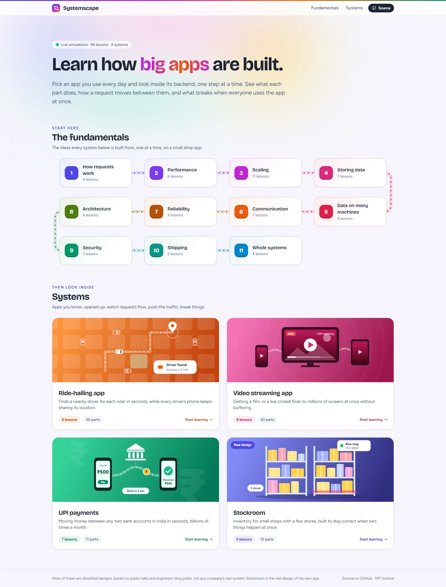
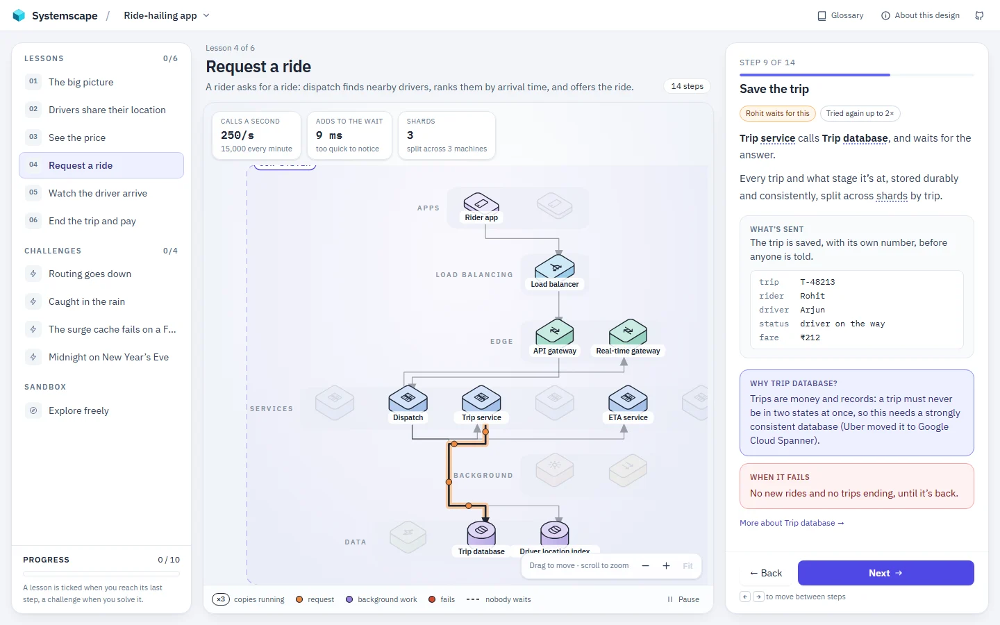
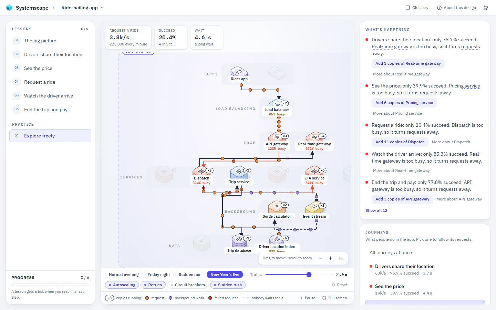
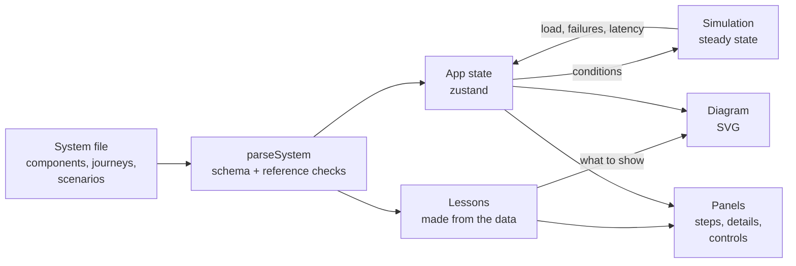

# Systemscape

[](https://github.com/iamrs77/systemscape/actions/workflows/ci.yml)

Learn how big apps are built, one step at a time. Pick an app you use every day and take its backend apart: what each part does, how a request travels through them, and what breaks when everyone shows up at once.

There are four systems so far: a **ride-hailing app** like Uber or Ola, a **video streaming app** like Netflix or Hotstar, **UPI payments** through an app like PhonePe or Google Pay, and [**Stockroom**](https://github.com/iamrs77/stockroom), my own inventory app, drawn from its real code.

New to system design? Start with **the fundamentals**: eleven tracks, 66 lessons (how requests work, performance, scaling, storing data, data on many machines, communication, reliability, architecture, security, shipping, and whole systems) that teach the ideas every system here is built from, one at a time, on a small shop app. Each lesson names every common way of doing it, how each works, what it costs, and when to choose it, and shows it happening: latency percentiles and napkin math, load balancing algorithms and layer 4 against layer 7, cache writes and stampedes, CDNs, autoscaling, SQL and the kinds of NoSQL, indexes, storage engines, transactions and isolation levels, replication, quorums, sharding, consistent hashing, unique IDs, CAP, consensus, REST, gRPC and GraphQL, queues, Kafka, WebSockets and webhooks, failover and disaster recovery, retries, circuit breakers, rate limiting algorithms, observability and SLOs, microservices, service discovery, sagas, stream processing, authentication, authorization, encryption, testing and deployments. The last track puts it all together: how to approach a design, then a URL shortener, a news feed and a chat app, built up a piece at a time.



## About

Architecture diagrams are static: they show the boxes, not what happens when Friday night arrives or the cache falls over. Systemscape puts a live model behind the diagram, and walks you through it.

- **Learn the ideas first.** The fundamentals teach one idea per lesson, on a shop app that grows as you go: each step draws only the parts it's about, changes one thing (the traffic, a bigger server, a cache, a second database) and shows the numbers that change with it.
- **Start with the big picture.** The first lesson goes through the system a row at a time, from the apps at the top to the data at the bottom: what each part is for, and why the design needs it.
- **Follow a request.** Each journey, like requesting a ride, is a lesson with a step per call: who calls whom, who waits, what's optional or happens in the background, and where the time goes. The diagram zooms in on each call as you go.
- **See what breaks.** Each lesson ends on a night that shows something new: too much traffic (a sudden rainstorm, New Year's Eve), or a part breaking (the maps, the surge cache, the payment provider). What gets overloaded, how the failure spreads, what keeps working, and how many requests still succeed.
- **Fix it yourself.** Each lesson ends by opening Explore freely on that night. Push the traffic up, take parts down, switch safety features on and off. Beside the diagram, every problem says what's failing and why, with a fix to try in one click: add copies of what's overloaded, bring back what's down, turn on circuit breakers. Full screen gives the diagram the whole screen, with the side panel there or hidden.
- **Check the sources.** The design is based on engineering talks and posts, listed with each system, and says plainly that it's a simplified version, not any company's actual system.



| What breaks in a sudden rainstorm                                                                                                  | Explore freely, with a fix for each problem                                                        |
| ---------------------------------------------------------------------------------------------------------------------------------- | -------------------------------------------------------------------------------------------------- |
|  |  |

## How it works

Everything runs in the browser. There's no server: a system is a data file, and the simulation runs every time you change something.



- **A system is data.** Components, the journeys through them and traffic scenarios live in one TypeScript file, checked by a zod schema and a second pass that every id it mentions exists. Any typo is reported, all at once, when the app loads.
- **The simulation finds where things settle.** Load and failures feed each other (failures cause retries, retries add load, load causes failures), so it iterates until the numbers stop changing. It models queueing delay, overload, timeouts, retries, circuit breakers, caches, optional and background steps, work that waits in a queue for a busy worker, time spent crossing the network, and autoscaling that can't keep up with a sudden rush. It's deterministic and takes under a millisecond.
- **The lessons write themselves.** They're made from the system's data: the big picture a row at a time, then a step per call of each journey, then the scenario that's hardest on it (found by running each one), then a step that opens Explore freely on it. A new system gets its lessons without writing any.
- **A diagram, drawn in SVG.** Each part is one soft, rounded block with its icon on a white disc on top; a database is a stack of discs, an app a phone, and a badge like ×3 says how many copies are running. Names sit on the blocks and arrows run between the rows, so neither hides the other. Drag to move it, scroll or pinch to zoom; each lesson step glides to the parts it's about. The drawing maths is pure functions, and every part's name is a button the keyboard reaches.
- **Follow one person.** Each journey follows Rohit (or Arjun, his driver) on one evening in Bengaluru, and every call shows what's actually sent: the pickup point, the trip number, the fare, and the answer that comes back.
- **Plain words and plain numbers.** Everything is written in simple English: short sentences, everyday words. Jargon is underlined the first time it appears on a card: tap it for a one-line meaning and an everyday comparison, from one glossary every system shares. Numbers come with what they mean: 55 ms is “under a blink”, 250 a second is “15,000 every minute”.
- **Every page has its own link.** The home page, each lesson and step, and Explore freely have their own address (`#/ride-hailing/learn/request-ride/3`), kept in the URL's hash so it works on any static host.
- **A front page with colour.** The fundamentals wind down the page as a path, one colour per track, joined by a line with dots moving along it. Each system has a colour of its own and a drawn, animated poster: a car crossing a city, a film going out live, a ₹ coin passing through the bank, a scanner sweeping the shelves. The lesson pages keep to one calm indigo, so the diagram stands out.
- **It works on phones.** The course folds into one button, and the step's explanation follows the diagram.
- **Small.** The whole app is 140 KB of JavaScript (gzipped), and needs no WebGL.

The design, the simulation's formulas and the reasons behind each decision are in the [documentation](#documentation).

## Tech stack

| Part        | Tools                                                              | Why                                                                                                                             |
| ----------- | ------------------------------------------------------------------ | ------------------------------------------------------------------------------------------------------------------------------- |
| App         | React 19, TypeScript, Vite                                         | Fast to build and reload, and strict types catch a broken system file before it runs.                                           |
| Diagram     | SVG, drawn by React                                                | Crisp at any size, with labels that are real buttons, and the drawing maths is plain functions.                                 |
| State       | zustand                                                            | One small store for the conditions and the simulation's result; components subscribe to just the slice they draw.               |
| Data checks | zod                                                                | Each system file is validated when the app starts.                                                                              |
| Styling     | Tailwind CSS 4, Bricolage Grotesque, Figtree and IBM Plex Mono     | Quick to build a consistent interface, with nothing to load at runtime; the fonts are bundled, not fetched from a font service. |
| Tooling     | ESLint (with the React Compiler's rules), Prettier, GitHub Actions | Checked on every push, along with the types and the build.                                                                      |

## Running it

You need Node.js 22 or newer.

```bash
npm install
npm run dev          # http://localhost:5173
```

| Command          | What it does                                        |
| ---------------- | --------------------------------------------------- |
| `npm run build`  | Type-checks and builds the static site into `dist/` |
| `npm run lint`   | ESLint                                              |
| `npm run format` | Prettier                                            |

The build is a static site with relative paths, so `dist/` can be served from any folder on any static host.

## Project structure

```
src/
  model/      the data format for a system (zod schema), and parseSystem, which checks it
  sim/        the simulation, number formatting, and the plain-words explanations
  systems/    one file per system, and the list of systems
  learn/      the lessons, made from a system's data, and the shared glossary
  diagram/    the diagram: layout and drawing maths (pure functions), and the SVG itself
  ui/         the home page, the course, the lesson and Explore freely screens, and their panels
  route.ts    which page you're on (home, a lesson step, Explore freely), from the URL's hash
  store.ts    the app's state, and the actions that re-run the simulation
docs/         architecture, design, decisions, and how to add a system
```

## Documentation

- [Architecture](docs/architecture.md): how the parts fit, the simulation in detail, the lessons and the diagram, and the limits.
- [Design](docs/design.md): the type, the colours, the front page's path and posters, the lesson pages, and the motion.
- [Adding a system](docs/adding-a-system.md): what goes in a system file, and how it's checked.
- Decision records:
  [1. A static site](docs/adr/0001-static-site.md) ·
  [2. A steady-state model](docs/adr/0002-steady-state-model.md) ·
  [3. Systems as data](docs/adr/0003-systems-as-data.md) ·
  [4. HTML labels over the canvas](docs/adr/0004-html-labels.md) ·
  [5. Honest about what's real](docs/adr/0005-honest-about-sources.md) ·
  [6. The tech stack](docs/adr/0006-tech-stack.md) ·
  [7. Pages in the URL's hash](docs/adr/0007-hash-routing.md) ·
  [8. A drawn diagram and guided lessons](docs/adr/0008-diagram-and-lessons.md) ·
  [9. Explore freely instead of challenges](docs/adr/0009-explore-instead-of-challenges.md) ·
  [10. A look of its own](docs/adr/0010-a-look-of-its-own.md)

## License

[MIT](LICENSE)
