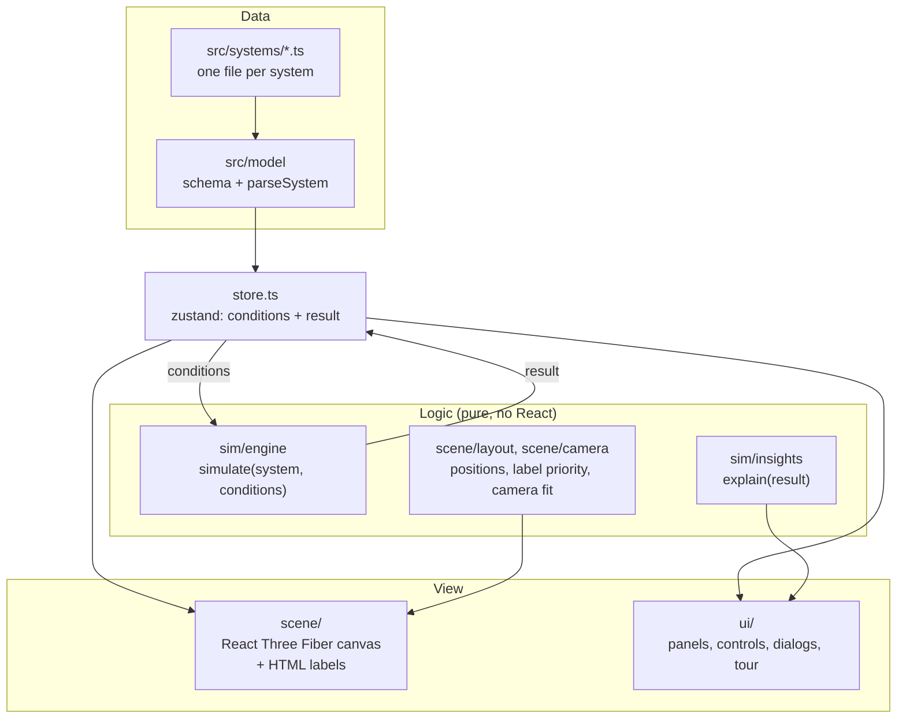

# Architecture

Systemscape is a browser app that draws a system's architecture in 3D and runs a simulation behind it. This document explains how the parts fit, how the simulation works, how the scene is drawn, and where the limits are. The reasons behind each decision are in the [decision records](adr).

## Constraints

- **Free to host, nothing to run.** It's a static site ([ADR 0001](adr/0001-static-site.md)).
- **Instant feedback.** Every change (a toggle, an instance, a traffic slider) re-runs the simulation, so it has to take well under a frame ([ADR 0002](adr/0002-steady-state-model.md)).
- **More systems are coming.** Adding one must mean writing data, not code ([ADR 0003](adr/0003-systems-as-data.md)).
- **Honest.** It teaches how real systems behave, so it has to say what's sourced and what's simplified ([ADR 0005](adr/0005-honest-about-sources.md)).

## Overview



Everything below the store is a pure function of its inputs, so most of the app is tested without a browser: the simulation, the explanations, the layout, the camera fit and every challenge.

| Folder         | What's in it                                                                                                                                                                                                       |
| -------------- | ------------------------------------------------------------------------------------------------------------------------------------------------------------------------------------------------------------------ |
| `src/model`    | The zod schema for a system, and `parseSystem`, which also checks every reference (a hop to a component that doesn't exist, a challenge naming a missing scenario) and lists every problem at once.                |
| `src/systems`  | One file per system, the registry (with the systems still to come), and the challenge helpers: a challenge's starting conditions, and whether a result meets its goal.                                             |
| `src/sim`      | The simulation, the plain-words explanations, and number formatting.                                                                                                                                               |
| `src/store.ts` | The conditions you've set, the latest result, what's selected and followed, the active challenge, and solved challenges (kept in `localStorage`). Every action that changes the conditions re-runs the simulation. |
| `src/scene`    | The 3D map. Loaded lazily, because three.js is most of the download.                                                                                                                                               |
| `src/ui`       | Everything that isn't the map.                                                                                                                                                                                     |

## The data

A system has **components** (a service, a database, a cache...) and **journeys**, the things people do, each a list of **hops** in the order they happen:

```ts
{ from: 'dispatch-service', to: 'eta-service', label: 'Arrival time for the closest drivers',
  calls: 5, optional: true }
```

A hop can be made by only some requests (`share`), several times per request (`calls`), retried (`retries`), skipped without failing the request (`optional`), handed off without the user waiting (`mode: 'async'`), or happen only when a cache can't answer (`onMiss`). Components have a capacity per instance, a base latency, an instance count, and optionally the most instances autoscaling may add. Caches have a hit rate.

**Scenarios** (presets) multiply the traffic, overall and per journey, and say whether it arrives suddenly. **Challenges** start from a scenario with some components down, and set a goal for one journey: a success rate, and optionally a latency.

[Adding a system](adding-a-system.md) covers the format in full.

## The simulation

`simulate(system, conditions)` works out the steady state: where load, failures and latency settle for the conditions you set. Load and failures depend on each other (failures cause retries, retries add load, load causes failures), so it iterates.

Each round:

1. **Send every journey's requests through its hops.** A journey starts with `rps × traffic × its own multiplier` requests at its first component. For each hop, the requests that reached `from` (times `share`, times `calls`) are sent to `to`. Behind a cache, only misses continue: `1 − hitRate`, and a cache that's down counts as a miss for every request.
2. **Retries.** If calls to a component fail with rate `f` and the hop retries `n` times, each try only happens when the one before failed, so a call is sent `1 + f + f² + … + fⁿ` times and still fails with rate `fⁿ⁺¹`. That's how retries hide small failure rates but pile load onto something already overloaded.
3. **Circuit breakers** (when switched on) open for a component when more than half of what's asked of it would fail. For a component that's down, callers stop calling except for 2% test calls, and fail at once. For one that's overloaded, the breaker keeps opening and closing, so calls get through up to its capacity, without retries, and the rest fail at once instead of timing out.
4. **What the user waits for.** Each synchronous hop adds the component's latency for calls that succeed, and a timeout for calls that fail (2 s per try, or 50 ms for a cache; nothing when a breaker fails it fast). Background (`async`) hops add nothing: their failures are counted separately, as background work that fails.
5. **Success.** A request fails when a required synchronous hop fails. An optional hop that fails makes it _degraded_ instead: it still works, just worse. A cache that fails isn't an error, just a miss.
6. **Each component reacts to its load.**
   - Autoscaling adds instances to stay at or below 70% busy, up to the component's limit, unless the traffic arrived suddenly; components without a limit (databases, streams, outside providers) only change when you change them.
   - A component asked for more than it can handle fails the excess: `1 − capacity ÷ load`. One that's down fails everything.
   - Latency grows with how busy it is, as in a simple queue: `latency ÷ (1 − busy)`, capped at the timeout.

Failure rates move halfway towards their new value each round, so retries and failures settle instead of swinging. It stops when nothing moves (or after 200 rounds); for the ride-hailing app, that's well under a millisecond. The result has each component's load, demand before retries, instances, how busy it is, failure rate, latency and breaker state; each journey's success, degraded share, latency, background failures and per-hop detail, including how much each hop adds to the wait; and the bottleneck.

`explain(system, conditions, result)` turns the result into sentences, most serious first: which journeys are failing and the component to blame, what's overloaded and why autoscaling didn't save it, retry storms, tripped breakers, graceful degradation grouped by the missing component, background failures, and slow journeys.

### Tested to be fair

`rideHailing.test.ts` checks that the ordinary evening and Friday night run without failures, and that **every challenge fails its goal at the start and is solved by a sensible fix**. If someone retunes a capacity and makes a challenge impossible or already solved, the tests fail.

## The 3D scene

- **Layout** (`scene/layout.ts`, pure): one row per layer, front to back: apps, edge, services, background, data, outside. Within a row, components are placed near the ones they connect to (by the average position of neighbours already placed), so fewer connections cross. Connections are curves arcing over what's between them.
- **Camera** (`scene/camera.ts`, pure): finds the closest camera position from which every row, its name and its labels fit on screen, by projecting them and searching the distance. On a tall screen it looks down more steeply. Switching to the top view or resizing moves the camera smoothly to the new fit.
- **Shapes**: a shape per kind (a phone for apps, a hexagonal gate, a box per service, stacked disks for databases, a pipe for streams, a sphere for outside providers), coloured by status. A ring on the ground shows how busy each one is; overloaded parts throb.
- **Requests**: dots on each connection, in a single instanced mesh. More traffic means more dots; the share of red dots is the share of calls that fail, and those fade out before arriving. Background work is violet and slower. The dots illustrate the result; they aren't the simulation itself.
- **Labels** ([ADR 0004](adr/0004-html-labels.md)) are HTML buttons over the canvas. Each frame, a tracker inside the canvas projects every label's point to the screen and moves it. Labels are placed most important first (selected, hovered, failing, busy, in the followed journey), and one that would overlap a label already placed is hidden until you point at it. On small screens they shrink to just the name.

## Accessibility

The 3D map is extra, not required. Every part is also a button (its label) with a description of its state, the journey steps link to each part, the explanations panel is a live region, the switches are real switches, and dialogs close with Escape and return focus to where you were. Animation starts paused for people who ask for reduced motion, and can be paused at any time.

## Testing

| Layer      | What                                                                                                                                                                                        | Where                    |
| ---------- | ------------------------------------------------------------------------------------------------------------------------------------------------------------------------------------------- | ------------------------ |
| Simulation | Hand-checkable numbers on a small system: cache misses, queueing, retries, breakers on dead and overloaded parts, degradation, background failures, autoscaling, sudden spikes, determinism | `src/sim/engine.test.ts` |
| Systems    | Every system parses; normal scenarios are healthy; every challenge starts failing and has a working fix                                                                                     | `src/systems/*.test.ts`  |
| Logic      | Explanations, formatting, layout, label priority, camera fit on wide, square and phone screens, and the store's rules (locks during challenges, clamping, saved progress)                   | `src/**/*.test.ts`       |
| Panels     | The whole app with the 3D scene stubbed, used like a person would: following a journey, inspecting and taking down a part, solving a challenge, the design write-up, the tour               | `src/App.test.tsx`       |
| Browser    | The production build in Chromium with WebGL, on a desktop and a phone, failing on any console error                                                                                         | `e2e/`                   |

## Limits

- **Steady state only.** It shows where things settle, not how they get there: no warm-up, no queues draining after a spike, no thundering herd at the moment a cache comes back. See [ADR 0002](adr/0002-steady-state-model.md).
- **Averages, not distributions.** Latency is a typical wait, not a p99.
- **Hops are sequential.** Calls a service makes in parallel are added up as if made one after another.
- **Illustrative numbers.** Capacities and traffic are chosen so the trade-offs show, not measured from any company.
