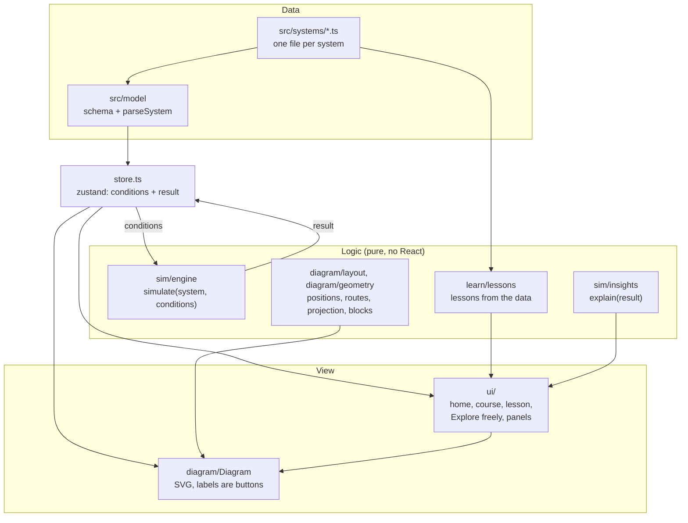

# Architecture

Systemscape is a browser app that teaches how a system is built: it draws the system's architecture as a diagram, runs a simulation behind it, and walks through it in lessons made from the system's data. This document explains how the parts fit, how the simulation works, how the lessons are made and the diagram drawn, and where the limits are. The reasons behind each decision are in the [decision records](adr).

## Constraints

- **Free to host, nothing to run.** It's a static site ([ADR 0001](adr/0001-static-site.md)).
- **Instant feedback.** Every change (a toggle, an instance, a traffic slider) re-runs the simulation, so it has to take well under a frame ([ADR 0002](adr/0002-steady-state-model.md)).
- **More systems are coming.** Adding one must mean writing data, not code ([ADR 0003](adr/0003-systems-as-data.md)).
- **Honest.** It teaches how real systems behave, so it has to say what's sourced and what's simplified ([ADR 0005](adr/0005-honest-about-sources.md)).

## Overview



Everything below the store is a pure function of its inputs: the simulation, the explanations, the lessons, the layout and the drawing maths.

| Folder         | What's in it                                                                                                                                                                                                                                      |
| -------------- | ------------------------------------------------------------------------------------------------------------------------------------------------------------------------------------------------------------------------------------------------- |
| `src/model`    | The zod schema for a system, and `parseSystem`, which also checks every reference (a hop to a component that doesn't exist, a hop from somewhere the journey hasn't reached) and lists every problem at once.                                     |
| `src/systems`  | One file per system, and the registry (with the systems still to come).                                                                                                                                                                           |
| `src/sim`      | The simulation, the plain-words explanations, and number formatting.                                                                                                                                                                              |
| `src/store.ts` | The conditions you've set, the latest result, what's selected and followed, and the lessons you've finished (kept in `localStorage`). Every action that changes the conditions re-runs the simulation.                                            |
| `src/learn`    | The lessons, made from a system's data, and what each step's diagram runs.                                                                                                                                                                        |
| `src/diagram`  | The diagram: where each part goes and how calls are routed (`layout.ts`), the projection and block shapes (`geometry.ts`), and the SVG (`Diagram.tsx`).                                                                                           |
| `src/ui`       | The home page, the course, the lesson and Explore freely screens, and their panels.                                                                                                                                                               |
| `src/route.ts` | Which page you're on, read from the URL's hash: `#/` is the home page, `#/ride-hailing/learn/request-ride/3` a lesson's third step, `/explore` Explore freely ([ADR 0007](adr/0007-hash-routing.md)). The store follows the system the URL names. |

## The data

A system has **components** (a service, a database, a cache...) and **journeys**, the things people do, each a list of **hops** in the order they happen:

```ts
{ from: 'dispatch-service', to: 'eta-service', label: 'Arrival time for the closest drivers',
  calls: 5, optional: true }
```

A hop can be made by only some requests (`share`), several times per request (`calls`), retried (`retries`), skipped without failing the request (`optional`), handed off without the user waiting (`mode: 'async'`), or happen only when a cache can't answer (`onMiss`). Components have a capacity per instance, a base latency, an instance count, and optionally the most instances autoscaling may add. Caches have a hit rate.

**Scenarios** (presets) multiply the traffic, overall and per journey, say whether it arrives suddenly, and can take parts down.

[Adding a system](adding-a-system.md) covers the format in full.

## The simulation

`simulate(system, conditions)` works out the steady state: where load, failures and latency settle for the conditions you set. Load and failures depend on each other (failures cause retries, retries add load, load causes failures), so it iterates.

Each round:

1. **Send every journey's requests through its hops.** A journey starts with `rps × traffic × its own multiplier` requests at its first component. For each hop, the requests that reached `from` (times `share`, times `calls`) are sent to `to`. Behind a cache, only misses continue: `1 − hitRate`, and a cache that's down counts as a miss for every request.
2. **Retries.** If calls to a component fail with rate `f` and the hop retries `n` times, each try only happens when the one before failed, so a call is sent `1 + f + f² + … + fⁿ` times and still fails with rate `fⁿ⁺¹`. That's how retries hide small failure rates but pile load onto something already overloaded.
3. **Circuit breakers** (when switched on) open for a component when more than half of what's asked of it would fail. For a component that's down, callers stop calling except for 2% test calls, and fail at once. For one that's overloaded, the breaker keeps opening and closing, so calls get through up to its capacity, without retries, and the rest fail at once instead of timing out.
4. **What the user waits for.** Each synchronous hop adds the component's latency for calls that succeed, and a timeout for calls that fail (2 s per try, or 50 ms for a cache; nothing when a breaker fails it fast). Background (`async`) hops add nothing: their failures are counted separately, as background work that fails.
5. **Success.** A request fails when a required synchronous hop fails. An optional hop that fails makes it _degraded_ instead: it still works, just worse. A cache that fails isn't an error, just a miss.
6. **Each component reacts to its load.**
   - Autoscaling adds instances to stay at or below 70% busy, up to the component's limit, unless the traffic arrived suddenly; components without a limit (databases, streams, outside providers) only change when you change them.
   - A component asked for more than it can handle fails the excess: `1 − capacity ÷ load`. One that's down fails everything.
   - Latency grows with how busy it is, as in a simple queue: `latency ÷ (1 − busy)`, capped at the timeout.

Failure rates move halfway towards their new value each round, so retries and failures settle instead of swinging. It stops when nothing moves (or after 200 rounds); for the ride-hailing app, that's well under a millisecond. The result has each component's load, demand before retries, instances, how busy it is, failure rate, latency and breaker state; each journey's success, degraded share, latency, background failures and per-hop detail, including how much each hop adds to the wait; and the bottleneck.

`explain(system, conditions, result)` turns the result into sentences, most serious first: which journeys are failing and the component to blame, what's overloaded and why autoscaling didn't save it, retry storms, tripped breakers, graceful degradation grouped by the missing component, background failures, and slow journeys.

### A fix for each problem

Explore freely lists what `explain` says, most serious first, and offers a fix beside each problem, once: enough copies to bring an overloaded part back to 70% busy, bring back a part that's down, turn on circuit breakers or autoscaling, or turn off retries in a retry storm. One click changes the conditions, and the simulation runs again.

## The lessons

`lessonsFor(system)` makes a system's course from its data ([ADR 0008](adr/0008-diagram-and-lessons.md)):

- **The big picture**: what the system does, how to read the diagram, then a step per row, from the apps down, naming every part in it with what it does.
- **A lesson per journey**, a step per call, in order: who calls whom and whether anyone waits, what the part being called does and why it's there (the first time it's met), what happens when it fails, and the numbers for that call (calls a second, the time it adds, copies), each with what it means in everyday terms. Optional calls, cache misses, retries and background work each get a note saying what they mean. When the system gives a journey a person and a scene, and a call an example, the lesson follows that person and shows what the call sends.
- **Where the time goes**: the whole journey, with each call's share of the wait.
- **Under load**: the scenario the journey names (or else the one that's hardest on it, found by running each) is shown: how the journey does, what went wrong and why, or what it doesn't depend on, and, when it still works but slowly, which part it's waiting on.
- **Try it yourself**: a link that opens Explore freely on that night, following this journey, with the fixes to try named (the same fixes the panel beside the diagram offers, from `sim/fixes.ts`).

Each step says what the diagram shows: which parts are lit, which calls are drawn and which one is being explained, and the scenario it runs.

### The basics: a hand-written course

The basics teach ideas rather than a product, so their lessons are written by hand, in tracks (`system.course`, built by `courseLessons` in `learn/course.ts`). The basics system is a small shop app holding every design its lessons compare: the same "look at a product" journey straight to the server, through a load balancer, with a cache, from a read copy. Those alternatives are switched off on an ordinary day (`journeyTraffic` 0), so Explore freely starts on the simple design.

A call can be more work than an ordinary request: a hop's `work` (20 for a search that reads every row, 30 for an upload passing through a server) multiplies the load it puts on the part it calls, and the time it takes. That's how the lessons show an index, a database built for writing, or uploads clogging the servers.

Each step names the parts to show, the journey to draw (and, with `draw`, others beside it), and its `Conditions` (`sim/scenario.ts`): which journeys run, the traffic, what's down, copies, bigger servers (`scale`), a cache's hit rate, and the safety features. The step's numbers are worked out by running the simulation under them, so the text and the facts can't drift apart. Its diagram is laid out with only those parts and journeys (`withOnly` in `diagram/layout.ts`), so a two-part step is a clean two-part picture, not two lit parts among faint ones, and a design that's switched off can't change how a call is drawn. Each lesson ends by opening Explore freely under the same conditions.

### Words, explained

`src/learn/glossary.ts` is one list of the words system design uses (request, cache, shard, circuit breaker…), each with a one-line meaning and, where it helps, an everyday comparison. `annotate(texts, names)` finds them in a card's text, whole words only and longest phrase first, and marks the first time each appears; journey names are left alone ("Request a ride" isn't a request), but the words in a part's name are explained ("Driver location **index**"). The panels underline those words, and tapping one opens its meaning beside it.

## The diagram

- **Layout** (`diagram/layout.ts`, pure): one row per layer, from the apps to outside providers, with a wider gap where our system ends. Within a row, components are placed near the ones they connect to (by the average position of neighbours already placed), so fewer calls cross. Calls are routed between the rows and columns, in straight lines and right angles, never through a part.
- **Drawing** (`diagram/geometry.ts`, pure): the layout is seen straight on, from above at an angle, so rows read top to bottom; each block is turned a quarter, so it shows two sides. A block is a rounded outline raised into a solid: the sides facing the viewer are shaded by which way they face, and the outline, a deeper shade of the block's own colour, is the same width at any size. Each part is one soft, rounded block with a glossy top, a soft shadow and its icon on a white disc: a database is a stack of three discs, an app a phone. How many copies a part runs shows as a ×3 badge, where copies matter (Explore freely, and the lesson step that explains them).
- **Calls and requests**: an arrow per call, dashed for background work; the call being explained is highlighted. Requests are dots moving along them (SVG animation, paused for people who ask for reduced motion): more for busier calls, red for the share that fails, fading before they arrive. The dots illustrate the result; they aren't the simulation itself.
- **Status**: an overloaded part turns red and one that's down grey and dashed; with load shown, each label says how busy its part is.
- **Names** are nameplates at the foot of each block, inside its lot, where no arrow goes; arrows arrive at the top of a lot and leave from the bottom. Each is an SVG button that tells screen readers the part's kind, how busy it is and how many copies it runs.
- **Zoom**: a lesson step zooms smoothly to the parts it's about, and the row names next to them; Explore freely zooms to the journey being followed, and can fill the screen, with its side panel shown or hidden. You can drag to move and scroll or pinch to zoom (two fingers on a phone, so one still scrolls the page); the next step fits it again.

## Accessibility

Every part on the diagram is a button (its label) with a description of its kind and state, every lesson step is reachable with the keyboard (and the arrow keys move between steps), the journey steps link to each part, the explanations panel is a live region, the switches are real switches, and dialogs close with Escape and return focus to where you were. Animation starts paused for people who ask for reduced motion, and can be paused at any time.

## Checks

There are no automated tests ([ADR 0009](adr/0009-explore-instead-of-challenges.md)). `parseSystem` checks each system file when the app loads, and every push runs ESLint (with the React Compiler's rules), Prettier, the TypeScript checker and the build.

## Limits

- **Steady state only.** It shows where things settle, not how they get there: no warm-up, no queues draining after a spike, no thundering herd at the moment a cache comes back. See [ADR 0002](adr/0002-steady-state-model.md).
- **Averages, not distributions.** Latency is a typical wait, not a p99.
- **Hops are sequential.** Calls a service makes in parallel are added up as if made one after another.
- **Illustrative numbers.** Capacities and traffic are chosen so the trade-offs show, not measured from any company.
